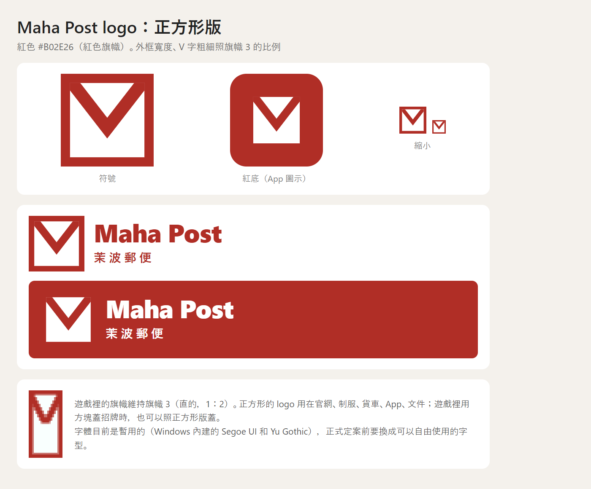

# 郵政

記錄本國的郵政 Maha Post（茉波郵便）。內容是 2026-11-06 和作者在另一個對話裡討論定案的，當時沒有寫進文件，2026-11-10 補記。

> 「待決定」的項目還在考慮中，Claude 的提案整理在最後的[待決定事項](#待決定事項)。

---

## Maha Post

本國唯一的郵政，以紐西蘭的 NZ Post 為藍本。

| 項目 | 設定 | 狀態 |
| --- | --- | --- |
| 名稱 | 茉波郵便（まはゆうびん），英文 Maha Post。見[名稱](#名稱) | 已定 |
| 子品牌 | 不設。快遞、宅配、行李宅配都直接用 Maha Post 的名字 | 已定 |
| 業務範圍 | 只做郵件與物流，不兼做銀行、保險。見[業務](#業務) | 已定 |
| 藍本 | 紐西蘭的 NZ Post | 已定 |
| 股權 | 政府百分之百持有，不上市 | 已定 |
| 主色 | 旗幟紅 `#B02E26`（紅色旗幟的顏色） | 已定 |
| Logo | 正方形的白色信封、紅色外框、紅色 V 字封口；遊戲裡用旗幟。見[Logo](#logo) | 已定，字體待決定 |
| 總部 | Asuka City 舊市區，靠港口、運河南側（約 X -34、Z -27）。下半部是日本時代的巴洛克風格老郵局，上半部是後來加蓋的玻璃帷幕大樓 | 已定，已經蓋好 |
| 郵遞區號與地圖符號 | 〒，日本時代留下來的。見[郵筒](#郵筒) | 已定 |

- 總部的建築是作者參考台北北門郵局和它的都更案，以及東京的 JP Tower 蓋的。JP Tower 是 2012 年完工的：1931 年的舊東京中央郵便局保留一部分外牆，上面加蓋 38 層大樓，一樓照樣是郵局櫃台
- 紅色在設定上說得通：本國經歷的兩個統治時代，郵筒都是紅的（日本從明治時期起、英國的 Royal Mail 也是）。香港 1997 年回歸後把郵筒全部漆成綠色，用意是去掉殖民色彩；本國的兩個前統治者都用紅色，紅色不偏向哪一邊，沿用下來最自然

### 名稱

| 名稱 | 現實意義 | 設定上的由來 |
| --- | --- | --- |
| 茉波郵便（まはゆうびん）、Maha Post | 作者取的（2026-11-06） | 英國時代的郵政部門全名叫 Mahaki Post Office；1988 年改組成公司時，縮短成口語的 Maha，對外叫 Maha Post，日文名茉波郵便。就像紐西蘭的 New Zealand Post Office 改組後對外叫 NZ Post |

- 現實裡幾乎每個國家的郵政都用國名：NZ Post、日本郵便、SingPost、Hongkong Post；例外很少，英國的 Royal Mail 是一個
- 名稱由來的寫法是 2026-11-10 改寫的（暫定）：11/6 討論時國名還是津蘭賀千良，茉波只是別稱，當時的說法是「老機構留舊名」，先例是斯里蘭卡改國名之後，錫蘭銀行（Bank of Ceylon）仍用舊名。作者 2026-11-09 在另一個對話把國名改成茉波（記在商業的分支 `claude/compassionate-tesla-cmpt0v`，2026-11-10 還沒併入主線），舊的說法就不成立了，Claude 改成上面的寫法，見[待決定事項](#待決定事項)
- 不設子品牌：現實裡人口差不多的國家也會設，例如紐西蘭的 CourierPost、新加坡郵政的 SpeedPost；作者決定不設。當時的候選 Myna（八哥）、Hina（雛）沒有用上

### Logo

決定經過（2026-11-06）：Claude 先畫了〒加波浪、茉莉花、只有字三個方向，再畫了六面用織布機做得出來的旗幟；作者選了第 3 面「信封（白底）」，品牌色選旗幟的紅（不用比較暗的紅色混凝土 `#8E2020`），並要求 logo 本身做成正方形。

| 檔案 | 內容 |
| --- | --- |
| `assets/maha-post/maha-post-symbol.svg` | 符號：紅色外框、白色信封、紅色 V 字封口（主要用這個） |
| `assets/maha-post/maha-post-symbol-on-red.svg` | 放在紅底上用的符號，沒有外框，紅底本身就是外框 |
| `assets/maha-post/maha-post-app-icon.svg` | App 圖示：紅色圓角方塊，中間放沒有外框的信封 |
| `assets/maha-post/preview.png` | 2026-11-06 給作者看的定案圖：符號、紅底版、縮小的樣子、符號加字標、遊戲裡的旗幟（字是暫用的字體） |
| `assets/maha-post/banner.png` | 遊戲裡的旗幟，照基岩版的官方材質畫的 |

| 部分 | 內容 |
| --- | --- |
| 符號 | 正方形。紅色外框，裡面是白色信封，紅色 V 字是信封的封口。外框寬度和 V 字粗細照旗幟的比例；縮到 32 像素還認得出來 |
| 字標 | 「Maha Post」，下面一行「茉波郵便」，都是旗幟紅；放在紅底上時改成白字。字體還沒定，見[待決定事項](#待決定事項) |
| 用法 | 正方形的 logo 用在官網、制服、貨車、App、文件；遊戲裡用旗幟，用方塊蓋招牌時也可以照正方形版蓋 |

| 顏色 | 色碼 | 遊戲中 | 用在 |
| --- | --- | --- | --- |
| 旗幟紅 | `#B02E26` | 紅色旗幟（就是它的顏色）；蓋招牌用紅色羊毛 `#A12722` 很接近 | 符號、字標、招牌 |
| 白 | `#FFFFFF` | 白色旗幟、白色混凝土 | 信封 |

- 和舊版 Gmail 的 logo 有點像，同樣是白色信封加紅色封口；差別是 Gmail 的信封是橫的、紅色畫成 M 字，也沒有完整的外框。信封本來就是郵件最常見的圖案，Claude 當時提醒過，作者確認可以
- 遊戲裡蓋郵局外牆如果用紅色混凝土，它比旗幟紅暗一點，可以當作品牌色的深色版（Claude 的建議）

#### 遊戲裡的旗幟

直的、1：2，就是 logo 的旗幟版。用織布機做，圖案名稱照基岩版繁體中文介面：

| 順序 | 顏色 | 圖案 |
| --- | --- | --- |
| 底色 | 白色旗幟 | — |
| 1 | 紅 | 對角交叉 |
| 2 | 白 | 下半部分填滿 |
| 3 | 紅 | 框邊 |

### 業務

作者 2026-11-06 確認（Claude 的草稿，作者說可以直接用）。

| 業務 | 內容 | 現實先例 |
| --- | --- | --- |
| 郵件 | 信件、明信片、郵票。法律規定全國同一個郵資，離島也要送到 | 各國郵政都有這個義務 |
| 包裹 | 國內包裹與宅配，是現在的主力。信件逐年減少，包裹因為網購逐年增加 | NZ Post、日本郵便都這樣轉型 |
| 行李宅配 | 在機場、車站、飯店之間送行李，讓觀光客空手旅行。AKQ 的櫃台就是辦這項業務 | 日本政府推的「手ぶら観光」 |
| 國際 | 國際郵件、國際快捷 | 各國郵政 |
| 企業物流 | 替企業倉儲、配送 | NZ Post、新加坡郵政都有 |
| 代辦 | 代收帳單；離島的櫃台代辦各家銀行的存提款 | 英國的郵局 |

- 不兼做銀行的理由：日本和台灣的郵政儲金能做這麼大，是因為過去鄉下沒有銀行，國家也靠郵政儲金籌錢蓋建設。本國是金融中心，信用卡也很普及，用不到
- 沖繩的小島上可能沒有銀行分行，由郵局櫃台代辦各家銀行的存提款補上

### 沿革

作者 2026-11-06 確認（Claude 的草稿）。和[電信的沿革](telecom.md#沿革)接在一起：電信原本也是郵政部門管的。

| 時期 | 經過 | 現實先例 |
| --- | --- | --- |
| 日本時代 | 日本的逓信省設郵便局；總部底下那棟巴洛克風格的老郵局，就是這個時期蓋的（年份待補） | 台北北門郵局（1930） |
| 英國託管 | 政府的郵政部門經營郵件和郵政儲金，兼管電話與電報。全名 Mahaki Post Office | 紐西蘭的郵政局、香港的郵政署 |
| 1960 年代獨立 | 照舊 | — |
| 1988 | 郵政部門一拆三：電信公司（現在的 Spoton，見[電信](telecom.md#沿革)）、郵政公司 Maha Post、郵政儲金銀行 | 紐西蘭 1987 年 |
| 1990 年代 | 郵政儲金銀行併入一家民間銀行 | 紐西蘭 1989 年賣給澳紐銀行；新加坡 1998 年併入星展銀行 |
| 2010 年代 | 總部都更：保留老郵局，在上方加蓋玻璃帷幕大樓 | 東京 JP Tower（2012）、台北北門郵局的都更案 |

- 政府百分之百持有、不上市：信件逐年減少，偏遠地區和離島的投遞虧錢要靠國家承擔，投資人不會有興趣；紐西蘭的郵政到現在也是國營。這點和上市的 Spoton 不同

### 據點

作者 2026-11-06 確認（Claude 的提案）。

| 種類 | 數量 | 內容 | 現實先例 |
| --- | --- | --- | --- |
| 郵局（直營） | 本島約 12 間：首都約 7 間（含總部一樓的總局）、犬山港約 4 間、地方約 2～3 間（例如寿豊、北部的盆地小鎮） | 什麼都能辦 | 新加坡、香港 |
| 代辦櫃台 | 幾十個，開在便利商店、超市裡 | 寄包裹、買郵票、領包裹 | 紐西蘭的合作商店 |
| 自助包裹櫃 | 車站、大型住宅區 | 24 小時取件、寄件 | 新加坡的 POPStation |
| 機場櫃台 | AKQ 出境大廳一間、入境大廳一間 | 見[AKQ 機場的櫃台](#akq-機場的櫃台) | 日內瓦、西雅圖機場的安檢寄件；日本機場的行李宅配櫃台 |
| 車站櫃台 | Asuka 中央車站 | 行李宅配，給搭黒潮特快的旅客 | 日本車站的行李宅配櫃台 |
| 郵件處理中心 | 一座，在 AKQ 旁邊 | 全國的郵件、包裹分揀，國際郵件從這裡進出 | 紐西蘭的國際郵件中心就在奧克蘭機場 |

| 地方 | 人口 | 郵局 | 平均每間服務多少人 |
| --- | --- | --- | --- |
| 新加坡 | 約 600 萬 | 44 間（2024 年，兩年內關了 12 間，改推自助包裹櫃） | 約 14 萬 |
| 香港 | 約 750 萬 | 122 間（含 3 輛流動郵局） | 約 6 萬 |
| 紐西蘭 | 約 530 萬 | 567 個據點（2026 年），大多開在超市、書店裡的代辦櫃台 | 約 1 萬 |
| 日本 | 約 1.2 億 | 約 2 萬 4 千間 | 約 5 千 |

- 本國人口高度集中在兩個城市，信用卡很普及，信件逐年減少，所以比較接近新加坡、香港，不會像日本那麼密
- 沖繩群島也有自己的郵局，但不蓋進地圖，數量不另外算
- 對建造的影響：要蓋的郵局建築大約十來棟（總部已經蓋好了），代辦櫃台和包裹櫃都是放在別的建築裡的小東西
- [建造清單](../build-checklist.md#參考建築)的參考建築有一棟「中央郵便局」，地點是犬山港
- 新加坡 2024 年把樟宜機場第二航廈的郵局關掉了，可見機場郵局不一定撐得起來。AKQ 的櫃台有「安檢寄回」和「行李宅配」兩個固定需求，說得通

資料來源：[NZ Post 2026 年調整零售據點（Scoop）](https://www.scoop.co.nz/stories/BU2601/S00253.htm)、[NZ Post 撤出 142 家都市合作商店（1News）](https://www.1news.co.nz/2026/01/27/nz-post-to-remove-mail-services-at-142-urban-retail-locations)、[新加坡郵政兩年關 12 間郵局（UOB Kay Hian 報告）](https://sginvestors.io/analysts/research/2024/10/singapore-post-uob-kay-hian-research-2024-10-10)、[新加坡郵政 2024 年的郵局合併公告](https://singpost.com/sites/default/files/2024-08/SingPost%20is%20moving%20to%20serve%20you%20better_v2.pdf)、[香港郵政（維基百科）](https://en.wikipedia.org/wiki/Hongkong_Post)

### 郵筒

作者 2026-11-06 確認（Claude 的提案）。兩個統治時代的郵筒都是紅色的，所以是「現代的郵筒，加上兩個時代留下來的老郵筒」。

| 種類 | 外觀 | 位置與數量 | 現實先例 |
| --- | --- | --- | --- |
| 現代郵筒 | 紅色方柱，正面印信封 logo；兩個投信口，左邊投信件和明信片，右邊投大型郵件、國際郵件和快捷 | 全國，本島約 230 個 | 日本現在的方形郵筒也是兩個投信口；數量照香港的比例（約 1,150 個，750 萬人）換算 |
| 英國時代的老郵筒 | 紅色圓柱，鑄著英國王室的縮寫徽號：GR（喬治六世，1952 年以前）或 EⅡR（伊莉莎白二世） | 舊市區、女王津，幾十個，照常使用 | 香港還留著幾十個刻王室徽號的老郵筒；1997 年後漆成綠色，本國不用改色 |
| 日本時代的老郵筒 | 紅色圓柱，頂上有帽簷，刻〒 | 舊市區，零星幾個 | 日本 1949 年起的圓筒形郵筒 |

- EⅡR 和女王津接得上：[命名](naming.md)的待決定事項裡，女王津的提案是英國人在 1953 年為了紀念伊莉莎白二世加冕而取的名字，女王津的老郵筒刻 EⅡR，故事就連起來了
- 〒繼續用：logo 雖然不是〒，但本國以日語為主，日常書寫照日本的習慣，郵遞區號前面寫〒，地圖上也用〒標示郵局。現實中日本郵便的 logo 是「JP」，〒也同時在用

---

## AKQ 機場的櫃台

AKQ 有兩個櫃台：出境大廳的郵局（兼行李宅配），和入境大廳的行李宅配櫃台。作者 2026-11-06 確認（Claude 的提案，作者說「照提案，入境也加」）。位置和蓋好的部分也記在[交通的大廳設施](transport.md#大廳設施)。

### 出境大廳的郵局

| 項目 | 內容 | 現實先例 |
| --- | --- | --- |
| 位置 | 出境大廳東南角（X 780～797、Z 473～484），管制區外。11/6 的提案原本是安檢入口旁，作者實際蓋在東南角 | 西雅圖機場每個安檢口旁都有寄件機台 |
| 安檢寄回 | 刀具、工具、超量的液體等，裝箱寄到國內的地址 | 日內瓦、羅里德罕（RDU）機場的寄回服務 |
| 安檢口的投遞箱 | 小東西不用離開排隊的隊伍：安檢人員給一個預付郵資的信封，寫好地址投進箱子，Maha Post 定時來收 | 日內瓦機場在安檢口提供專用信封 |
| 寄存 | 外國旅客沒有國內地址，而且刀具、酒類大多不能寄出國，可以寄放在櫃台，回程再領 | 法國尼斯機場的沒收物品寄存服務 |
| 行李宅配 | 出發前從飯店或家裡把行李寄到機場，在這裡領；回國時從這裡寄回家 | 日本機場的行李宅配櫃台 |
| 一般郵務 | 郵票、明信片、寄包裹；觀光客寄明信片回國 | — |
| 營業時間 | 第一班出發到最後一班出發 | — |
| 後場 | 前台和後場都在出境大廳這一層，後場在前台的紅磚牆後面（2026-11-07 蓋好）。最大的空間是樓下更大的儲存倉庫，坐走廊後面的貨梯下去（作者 2026-11-06 決定；倉庫還沒蓋） | — |

### 入境大廳的行李宅配櫃台

觀光客下飛機後，直接把大行李寄到飯店，空手搭車進市區。只收行李、不辦郵務，很小一個就夠了，約 25 m²（遊戲裡約 6 × 9 格）。行李當天就送走，不用倉庫，只要放 2 台籠車。日本的機場在入境大廳也有這種櫃台。位置還沒定，見[待決定事項](#待決定事項)。

### 參考：後場、設備與運作

作者 2026-11-06 問「後場要多大、要什麼設備、怎麼運作」，下面是 Claude 照 AKQ 旅客量估的參考數字，不是設定，蓋的時候照遊戲裡的空間調整。

**一天有多少事要做**（AKQ 一週出發 340 班，每班約 160 位旅客，一天約 7,800 人出發）

| 業務 | 一天大約 | 怎麼估的 |
| --- | --- | --- |
| 安檢寄回 | 3～5 件 | 約 0.5% 的旅客帶了違禁品，其中大約一成願意花錢寄回，其他人直接丟掉 |
| 行李宅配（出境，從飯店寄來機場領） | 約 200 件 | 約 3% 的旅客使用；本國是觀光國家，空手旅行很普遍 |
| 行李宅配（入境，從機場寄到飯店） | 約 200 件 | 同上，在入境櫃台收 |
| 明信片、包裹、郵票 | 50～100 筆 | 觀光客寄明信片回國 |

後場最主要的空間是放行李；安檢寄回其實量很少，是加分的服務。

**出境郵局的空間**（遊戲尺寸照[量體基準](../scale.md)的放大原則，每邊放大約 1.5 倍）

| 空間 | 設定大小 | 遊戲裡約 | 內容 |
| --- | --- | --- | --- |
| 前台（客人那側＋櫃台） | 約 40 m² | 9 × 10 格 | 3 個窗口、排隊區、打包桌、寄件機、包裹櫃、郵筒 |
| 行李倉庫 | 約 65 m² | 12 × 12 格 | 三層的重型貨架，最多放約 250 件行李 |
| 待運區 | 約 10 m² | 4 × 6 格 | 2～3 台籠車（附輪子的鐵籠），放要送走的郵件、包裹 |
| 寄存架 | 約 8 m² | 3 × 6 格 | 外國旅客寄放的刀具、酒，回程再領 |
| 工作檯 | 約 10 m² | 4 × 6 格 | 打包安檢寄回的東西 |
| 辦公室 | 約 20 m² | 6 × 8 格 | 主管桌、2～3 個座位、保險箱、監視器螢幕 |
| 員工休息室、置物櫃 | 約 15 m² | 5 × 7 格 | 廁所用航廈的員工廁所 |
| 合計 | 約 170 m² | 約 20 × 20 格 | 前台約四分之一，後場約四分之三 |

**設備**

- 前台：刷卡機（本國很少用現金）、電子秤、標籤印表機、條碼掃描器、叫號機、郵票和明信片的展示架、紙箱和膠帶的貨架、寄件機、包裹櫃、郵筒
- 紀念郵戳：印著 AKQ 或飛機圖案的郵戳，觀光客可以蓋在明信片上。日本郵局的「風景印」就是這種東西，很受觀光客歡迎
- 後場：重型貨架、籠車、手推車、量行李的大型磅秤、標籤印表機、保險箱、監視器、一扇通往員工通道的後門

**一天怎麼運作**

| 時間 | 發生的事 |
| --- | --- |
| 前一天傍晚～清晨 | 宅配貨車把旅客從飯店寄來的行李送到航廈的卸貨區，用貨梯運上來，照航班時間上架 |
| 第一班出發前開門 | 旅客出示手機上的取件 QR 碼，店員從倉庫推出行李，旅客自己去報到託運 |
| 整天 | 安檢被擋下的旅客走過來；秤重、打包、刷卡付款，放進籠車。安檢口投遞箱的信封每小時收一次 |
| 每天幾次 | 處理中心（就在 AKQ 旁邊）的車來收籠車，把郵件和包裹送去分揀 |
| 入境櫃台，整天 | 收行李、貼標籤，貨車每 1～2 小時來收一次，當天傍晚送到飯店 |
| 最後一班出發後 | 關門、結帳、清點寄存品；超過保管期限（例如 30 天）的寄存品照規定處理 |

人力：出境郵局分早晚兩班，每班 3～5 人（窗口 2～3 人、倉庫 1～2 人），總共約 12～15 人輪班；入境櫃台約 4～5 人輪班。

資料來源：[日內瓦機場：寄回安檢沒收的物品](https://www.gva.ch/en/passengers/travel-preparation/services/our-services/Envoi-d-articles-retires-au-controle-de-surete)、[西雅圖機場的安檢寄件機台](https://www.portseattle.org/node/2309)

---

## 待決定事項

- [ ] **字體**：logo 的字標目前用 Windows 內建的 Segoe UI 和 Yu Gothic，只是暫用。正式使用前換成可以自由使用的字型（SIL 開放字型授權），像 Asuka Air 選 Syne 那樣。作者 2026-11-06 決定先放著
- [ ] **名稱由來的新寫法**：國名改成茉波以後，Claude 把由來改成「英國時代叫 Mahaki Post Office，1988 年改組時縮短成口語的 Maha，像 NZ Post」，見[名稱](#名稱)。等作者確認
- [ ] **郵政儲金銀行併入哪一家**，Claude 的提案：併入[茉波銀行](banks.md#茉波銀行)。11/6 定的是「併入一家民間銀行」，但後來（11/7）定下的四大銀行裡，本國的大銀行只有公股的茉波銀行，其他三家都是外國銀行的子行。先例：新加坡的郵政儲金銀行 1998 年併入星展銀行，星展的大股東是政府的淡馬錫
- [ ] **總部老郵局的年份**：日本時代蓋的，哪一年待補（藍本台北北門郵局是 1930 年）
- [ ] **入境行李宅配櫃台的位置**：AKQ 到達層（B1）的入境大廳裡，還沒定
- [ ] **郵筒的蓋法**：遊戲裡怎麼蓋，作者可能有自己的做法；需要的話 Claude 可以提蓋法，或做成 Asuka tech 的自製方塊（照規定要一併提原版替代）

### 已定（2026-11-06）

- [x] 只做郵件與物流，不兼做銀行；藍本 NZ Post
- [x] 業務與沿革照 Claude 的草稿；政府百分之百持有、不上市
- [x] 名稱茉波郵便、Maha Post（まはゆうびん），不設子品牌
- [x] logo 用旗幟 3（信封，白底），做成正方形；品牌色旗幟紅 `#B02E26`
- [x] 據點：本島約 12 間郵局，加上代辦櫃台、自助包裹櫃、機場與中央車站的櫃台、AKQ 旁邊的郵件處理中心
- [x] 郵筒：現代的方形郵筒，加上英國時代與日本時代的圓筒老郵筒；〒繼續用
- [x] AKQ 出境大廳的郵局照提案，入境大廳加一個行李宅配櫃台
- [x] AKQ 郵局的後場在出境大廳同一層，最大的倉庫在樓下，坐貨梯下去
