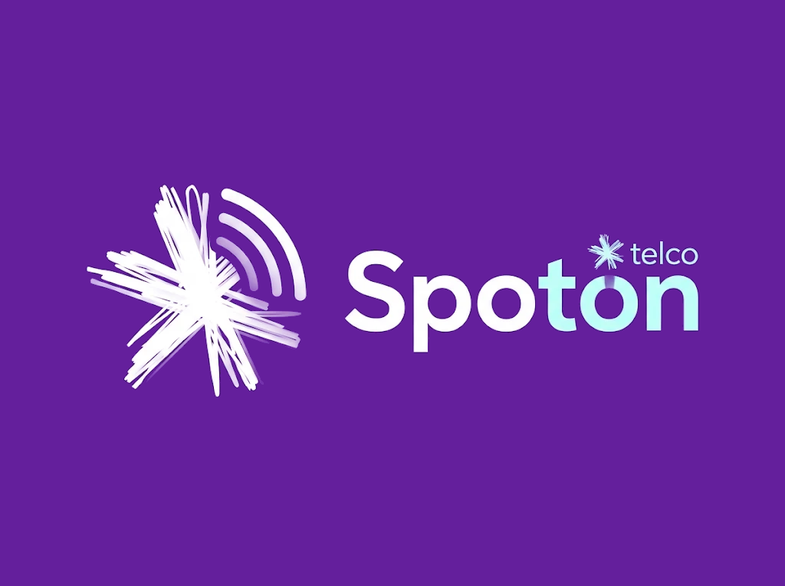

# 電信

記錄本國的電信業者。目前只處理第一大的電信公司 Spoton。

> 「待決定」的項目還在考慮中，Claude 的提案整理在最後的[待決定事項](#待決定事項)。

---

## Spoton

本國第一大的電信公司，以紐西蘭的 Spark 為藍本。

| 項目 | 設定 | 狀態 |
| --- | --- | --- |
| 名稱 | Spoton | 已定 |
| 平價子品牌 | Homie | 已定 |
| 地位 | 本國第一大的電信公司 | 已定 |
| 藍本 | 紐西蘭的 Spark | 已定 |
| 品牌元素 | 學 Spark 的紫色與星形 | 已定 |
| 日文寫法 | スポットオン（片假名） | 已定 |
| Logo | 白色的手繪星形加三道訊號弧線，字標 Spoton，紫色混凝土色的底。見[Logo](#logo) | 已定 |
| 舊名 | Tu Rangatira Telecom（1988～2015 年），民間至今仍有人叫它 Telecom | 已定 |
| 股權 | 主權基金持股過半，其餘股份上市 | 已定 |
| 主色 | 紫色混凝土的紫 `#641F9C`，配白與薄荷色。見[Logo](#logo) | 已定 |

### 名稱

只取英文名，不另取日文漢字名。

| 名稱 | 現實意義 | 設定上的由來 |
| --- | --- | --- |
| Spoton | 作者 Keep 筆記裡的英文候補，作者喜歡的名字 | spot on 是「恰到好處、正中目標」，訊號永遠準確送到；spot 也是光點和 Wi-Fi 的熱點（hotspot），接上星形的 logo。2015 年改名時取的 |
| Homie | 作者 Keep 筆記裡的英文候補，作者喜歡的名字 | 英文口語的「自己人、好朋友」，親切的語氣適合給年輕人的平價品牌 |

- 改名的理由和 Spark 一樣：Telecom 這個名字跟不上公司多角化的業務
- 現實中美國有一家做餐廳收銀系統的 SpotOn，業種不同

### Logo

作者設計。底色原本是深紫 `#300A59`，作者決定改成紫色混凝土的顏色 `#641F9C`，遊戲裡蓋出來的招牌和 logo 同色。



| 檔案 | 內容 |
| --- | --- |
| `assets/spoton/spoton-logo.png` | 符號加字標，紫色混凝土色的底（現行版） |
| `assets/spoton/spoton-symbol.png` | 只有符號，紫色混凝土色的底（現行版） |
| `assets/spoton/original/spoton-logo-original.webp` | 作者的原圖，符號加字標，深紫底 |
| `assets/spoton/original/spoton-symbol-original.webp` | 作者的原圖，只有符號，深紫底 |
| `assets/spoton/tools/recolor.py` | 把原圖的底色換成紫色混凝土色的程式 |

| 部分 | 內容 |
| --- | --- |
| 符號 | 白色的星形，由很多手繪感的線條疊成，像 Spark 的星形；右上方三道同心的訊號弧線，越往內越淡 |
| 字標 | 「Spoton」，幾何感的無襯線字體。「Spo」白色，「ton」薄荷色 |
| 小字 | 「telco」，前面接一顆小星形，放在字標右上方 |
| 底色 | 紫色混凝土的紫 |

| 顏色 | 色碼 | 遊戲中 | 用在 |
| --- | --- | --- | --- |
| 紫 | `#641F9C` | 紫色混凝土（色碼就是它的材質平均色） | 底色、門市外牆、招牌底 |
| 白 | `#FFFFFF` | 白色混凝土 | 符號、字標的「Spo」 |
| 薄荷色 | `#C4FEF8`（從原圖量的） | 待決定 | 字標的「ton」、小字 telco |

換底色的方法：把每個像素看成「前景色＋舊底色」的混合，只把舊底色換成新的，白色、薄荷色和邊緣的柔邊、訊號弧線的漸淡都保留。重新產生：

```bash
python3 -I assets/spoton/tools/recolor.py assets/spoton/original/spoton-logo-original.webp assets/spoton/spoton-logo.png 300A59 641F9C
```

```bash
python3 -I assets/spoton/tools/recolor.py assets/spoton/original/spoton-symbol-original.webp assets/spoton/spoton-symbol.png 2C0B56 641F9C
```

兩張原圖的底色略有不同（`#300A59`、`#2C0B56`），所以分開指定。

- 星形來自 Spark，訊號弧線表示電信，兩者合起來是「訊號從一個光點（spot）發出」
- 星形和 Spark 很像：Spark 只在紐西蘭營業，商標是分國註冊的，在本國不會有商標問題；加上訊號弧線和字標，整體也和 Spark 分得開。比起先前以 Spotify 為原型的方案，問題小很多
- 原圖是點陣圖，正式使用前要描成向量檔

### 沿革

作者交由 Claude 決定。

| 年份 | 經過 | 現實先例 |
| --- | --- | --- |
| 1896～1897 | 日本鋪設鹿兒島、奄美大島、沖繩、石垣、台灣淡水之間的海底電信線，原本由陸軍管理，後來移交逓信省。本國位在鹿兒島和奄美之間，線路在本島設中繼的陸揚室（地點待補，見下方說明） | 臨時台湾電信建設部鋪設的這條線是真實存在的；石垣島的海底電線陸揚室（1897 年）現為沖繩縣的史跡，當地叫「電信屋」 |
| 日本外地時期 | 逓信省經營郵政、電報、電話 | — |
| 英國託管時期 | 政府的郵政部門兼管國內的電話與電報；國際通訊交給英國的 Cable & Wireless 經營 | 紐西蘭的郵政局直到 1987 年都兼管電信；香港的國際通訊由 Cable & Wireless 獨家經營 |
| 1960 年代獨立 | 郵政部門照舊兼管電信；政府買下 Cable & Wireless 在本國的國際業務，併入郵政部門 | — |
| 1988 | 電信從郵政分出來，成立國營的 Tu Rangatira Telecom | Telecom NZ（1987 年從郵政局分出） |
| 1994 | 上市，主權基金保留過半股份 | Singtel（1993 年上市，淡馬錫至今持股過半） |
| 2015 | 改名 Spoton，換上紫色的星形 logo | Telecom 改名 Spark（2014 年） |
| 2017 | 推出平價子品牌 Homie | Spark 的 Skinny（2012 年） |

- 陸揚室（りくあげしつ）：海底電纜拉上岸的小屋，「陸揚」是日文的「卸到岸上」。電纜在這裡接上陸地的線路，再通到電信局。現代的同類設施叫海纜登陸站，例如中華電信的頭城海纜站
- 從 1897 年起，本國就是海底電纜的中繼點，和現在居中者的角色接得上
- 改名之後，民間仍有人叫它 Telecom，就像本國的別稱茉波
- 主權基金持股過半：國家掌握通訊這種關鍵基礎建設，經營上又是一般的上市公司

### 業務

作者交由 Claude 決定。

| 業務 | 品牌 | 內容 |
| --- | --- | --- |
| 個人 | Spoton | 手機（5G）、家用光纖、市話，門市服務 |
| 平價 | Homie | 只在網路與 App 上賣，沒有門市；方案便宜，給年輕人；用 Spoton 的網路 |
| 企業 | Spoton Business | 企業網路、雲端、資安 |
| 國際 | Spoton | 海底電纜登陸站、國際專線、資料中心。本國的特色是居中者：日、韓、台、中的企業把資料放在中立的地方 |
| 批發 | Spoton | 光纖線路留在 Spoton，不拆分，但必須用相同的條件批發給其他業者 |
| 公共 Wi-Fi | Spoton | 公共電話亭改成免費的 Wi-Fi 熱點 |
| 冠名贊助 | Spoton | 場館的冠名，像 Spark Arena |
| 公益 | Spoton Foundation | 基金會 |

- 不做串流影音：Spark 的 Spark Sport 在 2023 年停止，Lightbox 在 2019 年賣給 Sky，小市場撐不起來
- 光纖不拆分：紐西蘭把線路拆給 Chorus，新加坡拆給 NetLink；本國照日本的做法，NTT 東日本、西日本保有光纖，批發給其他業者用自己的品牌賣（「光コラボ」）。主權基金已經持股過半，國家本來就掌握這張網路，不需要另外成立一家公司

### 藍本：Spark

| 年份 | 事件 |
| --- | --- |
| 1987 | 從紐西蘭郵政局的電信部門分出來，成立 Telecom |
| 1990 | 民營化，賣給美國的 Bell Atlantic 與 Ameritech |
| 2009 | 推出星形的 logo |
| 2011 | 固網的線路拆給 Chorus，Telecom 保留零售與行動業務 |
| 2012 | 推出給年輕人的平價子品牌 Skinny |
| 2014 | 8 月 8 日改名 Spark，沿用星形 logo |
| 2017 | 取得奧克蘭 Vector Arena 的冠名，改稱 Spark Arena |
| 2024 | 員工 5,291 人，市占約 4 成 |

---

## 待決定事項

- [ ] **字標的細節**，Claude 注意到的地方：
  - 「on」的 o 頂端有一個缺口和一小段直線，看起來像電源符號 ⏻（on＝開機），和名字很搭。如果是刻意的就保留；如果是生成時的瑕疵，描成向量時要決定留不留
  - 顏色在「Spo｜ton」之間切開，但名字的由來是「spot｜on」。想強調 on（開、訊號開著）的話，改成「Spot」白、「on」薄荷色比較合理
- [ ] **A2 廣告的底色**：[廣告清單](../ads.md)的 A2（`addon/drafts/ads/originals/Spoton電信.jpg`）用的是原本深紫底的 logo，要不要換成紫色混凝土色的版本
- [ ] **向量化**：原圖是點陣圖，正式使用前描成 SVG（星形、訊號弧線、字標分開，像 Asuka Air 一樣）
- [ ] **Homie 的片假名**，Claude 的提案：ホーミー
- [ ] **冠名的場館**，Claude 的提案：北流（台北流行音樂中心類型的展演場館），叫 Spoton Arena
- [ ] **業者數量**，Claude 的提案：全國共三家行動業者，Spoton 的市占約 45%，另外兩家之後再設計。人口相近的小國多半也是三家（紐西蘭三家：Spark、One NZ、2degrees）。第二大是 Asuka Inc. 的電信子公司（作者 2026-11-09，見 [Asuka Inc.](asuka-inc.md#集團架構)）
- [ ] **陸揚室的地點**：明治時期的主要港口在茉波城市，可以放在它附近；海底電纜的登陸點也常選在船少的偏僻海灣，避免被船錨勾斷（石垣島的陸揚室就在偏僻的屋良部半島）

### 色彩與主視覺

- [ ] **薄荷色用哪個方塊**：Claude 量了 Bedrock 官方材質的平均色，沒有剛好的方塊

  | 方塊 | 平均色 | 說明 |
  | --- | --- | --- |
  | 海燈籠 | `#ACC7BE` | 會發光，適合招牌的字 |
  | 鑽石方塊 | `#62EDE4` | 顏色比較飽和 |

  - 紫色的其他方塊避免使用：紫珀方塊（偏粉，有終界的感覺）、紫色陶土（偏褐）、洋紅色混凝土（太粉）
- [ ] **主視覺**：紫底白 logo 為主；不用漸層（方塊做不出來）

### 量體

- [ ] **規模**，Claude 的粗估：

  | 項目 | 粗估 | 依據 |
  | --- | --- | --- |
  | 員工 | 約 1,700 人 | Spark 5,291 人，紐西蘭約 530 萬人、市占約 4 成；本國 150 萬人、市占約 45% |
  | 總部 | 10～15 層的大樓，約 15,000 m² | 辦公室人員約 1,000 人，每人約 15 m²；其餘在門市、機房與外勤 |
  | 門市 | 全國約 15～20 家：首都約 10 家、茉波城市約 5 家、地方幾家 | 粗估。Homie 沒有門市 |

### 遊戲中的建築

- [ ] **要蓋的建築**，Claude 的提案：

  | 建築 | 說明 |
  | --- | --- |
  | 總部 | 10～15 層，見量體 |
  | 旗艦店與門市 | 紫色混凝土外牆加白色 logo |
  | 海底電線陸揚室 | 1897 年的歷史建築，參考石垣島的電信屋 |
  | 海底電纜登陸站、資料中心 | 現代的設施，可以蓋在陸揚室附近，表示這裡一百多年來都是中繼點 |
  | 電話亭、屋頂基地台 | 城市細節；電話亭兼 Wi-Fi 熱點 |

### 已決定

- [x] 本國第一大的電信公司，以紐西蘭的 Spark 為藍本，學它的紫色與星形
- [x] 名稱取英文名，不另取日文漢字名（璃音、結迅、礼音這類漢字名不用）
- [x] Logo 由作者自己設計；Claude 提的三案（流線光芒、桔梗星、閃光）都不採用，也不重畫
- [x] 日文寫法：スポットオン
- [x] Logo 定案：作者設計的白色手繪星形加三道訊號弧線，字標 Spoton（Spo 白、ton 薄荷色）加小字 telco
- [x] Logo 的底色從深紫 `#300A59` 改成紫色混凝土的顏色 `#641F9C`；這也是 Spoton 的主色
- [x] 不採用的 logo 方向：以 Spotify 標誌的紫色版為原型、弧線下方加一個點、把三條線連成 S（順暢版、筆刷版）
- [x] 名稱：Spoton；平價子品牌：Homie（都取自 Keep 筆記的英文候補）
- [x] 沿革與業務：作者交由 Claude 決定，內容見[沿革](#沿革)與[業務](#業務)
- [x] 舊名 Tu Rangatira Telecom，2015 年改名 Spoton；2017 年推出 Homie
- [x] 主權基金持股過半，其餘股份上市
- [x] 光纖線路不拆分，留在 Spoton，用相同的條件批發給其他業者
- [x] 不做串流影音
